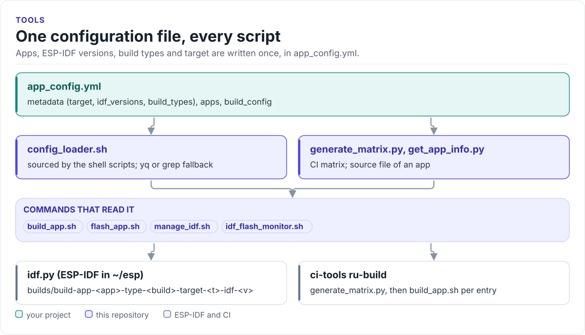

# ESP-IDF Project Tools

Shell and Python scripts that build, flash and monitor every app of a multi-app ESP-IDF project from one
`app_config.yml`, on your machine and in CI.

[](https://github.com/kokeb-labs/espidf-tools/actions/workflows/yamllint.yml)
[](https://kokeb-labs.github.io/espidf-tools/)
[](LICENSE)

**Documentation: <https://kokeb-labs.github.io/espidf-tools/>**

<!-- figure: tool-map -->
<picture>
  <source media="(prefers-color-scheme: dark)" srcset="docs/diagrams/tool-map.dark.svg">
  
</picture>
<!-- /figure -->

## In 30 seconds

With the apps listed in `examples/esp32/app_config.yml` and these scripts in `examples/esp32/scripts`:

```bash
./scripts/build_app.sh list                     # apps, build types, ESP-IDF versions
./scripts/build_app.sh gpio_test Debug          # build into builds/build-app-gpio_test-type-Debug-...
./scripts/flash_app.sh gpio_test Debug          # flash and monitor; finds the port, builds if needed
```

## What it does

- Builds each app, build type and ESP-IDF version into its own folder under `builds/`, so switching never
  reuses another build's cache.
- Refuses combinations `app_config.yml` does not allow, and lists the ones it does.
- Installs and exports the ESP-IDF versions the project asks for, under `~/esp`.
- Finds the board's serial port on Linux and macOS, flashes, monitors and logs the monitor output.
- Turns `app_config.yml` into the GitHub Actions matrix that
  [ci-tools](https://github.com/kokeb-labs/ci-tools) builds, with size files for its report.

## Install

```bash
cd examples/esp32
git submodule add https://github.com/kokeb-labs/espidf-tools.git scripts
pip install -r scripts/requirements.txt
```

The project's `main` component compiles the file `build_app.sh` passes as `APP_SOURCE_FILE`; see
[Project layout](https://kokeb-labs.github.io/espidf-tools/latest/project-layout/).

## Documentation

| Page | What it covers |
| --- | --- |
| [Quickstart](https://kokeb-labs.github.io/espidf-tools/latest/quickstart/) | Add the scripts, describe an app, build and flash |
| [app_config.yml](https://kokeb-labs.github.io/espidf-tools/latest/app-config/) | Every key, its default and which script reads it |
| [build_app.sh](https://kokeb-labs.github.io/espidf-tools/latest/build-app/) | Arguments, build folders, size files, CMake variables |
| [flash_app.sh](https://kokeb-labs.github.io/espidf-tools/latest/flash-app/) | Operations, port search, logging |
| [manage_idf.sh](https://kokeb-labs.github.io/espidf-tools/latest/manage-idf/) | ESP-IDF versions under `~/esp` |
| [Using in CI](https://kokeb-labs.github.io/espidf-tools/latest/ci/) | The matrix and the build in GitHub Actions |

## Tests

```bash
cd examples/esp32/scripts/tests && ./test_tab_completion.sh
```

## Contributing

Commits are signed off (`git commit -s`); pull requests run the DCO check, the script tests and the docs build
behind one `CI gate` check. Changes are listed in [CHANGELOG.md](CHANGELOG.md).

## License

MIT; see [LICENSE](LICENSE).
